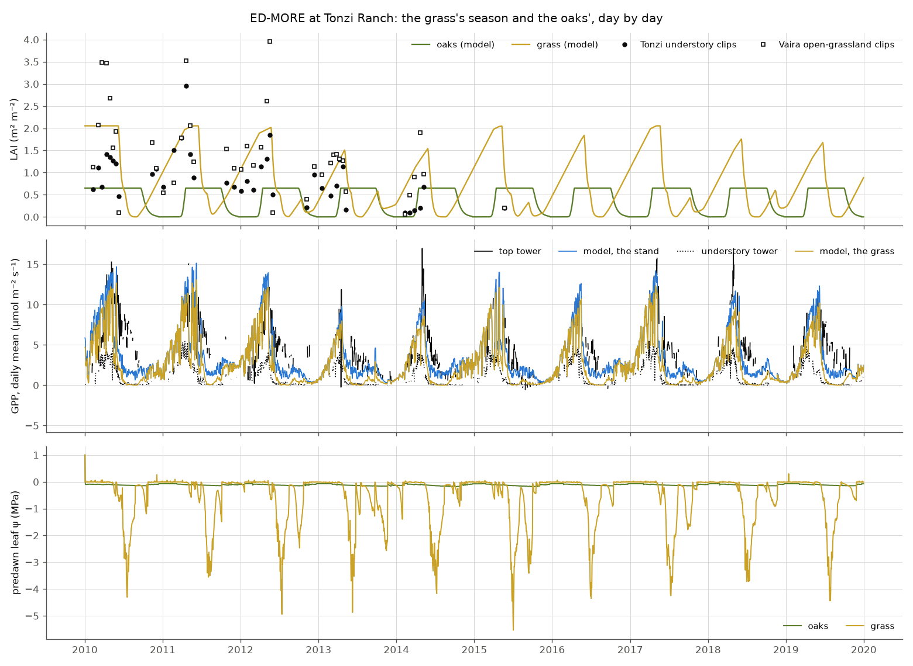

# Example 04, Tonzi Ranch — a blue-oak savanna and its grass (prototype)

Example 04's pipeline at a savanna: deciduous blue oaks over a C3 annual grass in the Sierra Nevada
foothills of California, the AmeriFlux tower US-Ton (23.5 m), 2010–2019. It is ED-MORE's first stand
with a plant that is not a tree: the grass has no stem, stands at its plant type's height and changes
only its leaf area ([`docs/science/plant_carbon_allocation.md`](../../../../docs/science/plant_carbon_allocation.md)
§2). **Status: prototype.**

The example:

1. builds the forcing from the tower's meteorology, with Vaira Ranch's where Tonzi measured nothing;
2. starts a frozen stand: oaks imputed from the site survey's stand averages, and the grass beneath and
   between them; its leaves follow the phenology fitted in example 02, part 3;
3. calibrates the fast parameters of both plant types against the tower;
4. compares the default and the calibrated runs with the top tower, the understory's eddy covariance
   and the clip LAI.

## Run

```bash
cd examples/example04_column_biophysics/sites/tonzi
python run_site.py --ameriflux AMF_US-Ton_FLUXNET_2001-2025_v1.3_r1.zip --badm <base>
python run_site.py ... --forcing-only          # the tower file and the forcing only
python run_site.py ... --calibrate --workers 60
```

`<base>` is the folder holding AmeriFlux's BASE-BADM zips of US-Ton and US-Var
(`AMF_US-Ton_BASE-BADM_27-5.zip`, `AMF_US-Var_BASE-BADM_27-5.zip`); they and the FLUXNET zip need an
AmeriFlux account. Ten years take about a minute on 16 threads with the dev build; with `--calibrate`,
every step takes 9 minutes on 60 cores.

## The data

| Input | Source |
|---|---|
| Meteorology and fluxes | AmeriFlux US-Ton FLUXNET (ONEFlux v1.3_r1), CC-BY-4.0. Measured values only: [`prepare_tower.py`](prepare_tower.py) blanks the product's fills, and [`make_tower_forcing.py`](../../../../scripts/prepare_input/flux_tower/make_tower_forcing.py) fills the gaps by its own rules |
| Rain and pressure | US-Ton's BASE file (BASE-BADM 27-5; the FLUXNET product has none before 2021). Where Tonzi has none, or its file holds Vaira's readings, Vaira Ranch's (US-Var, 2.4 km away, 48 m lower) |
| Longwave | measured at Tonzi from 2014. Before, Vaira's less its mean excess over Tonzi's where both measure (10.4 W m⁻² over 2014–2019): half-hourly RMSE 12.1 W m⁻², against 21.8 for the forcing tool's own fill |
| Understory | the second eddy covariance system, about 2 m above the ground (Baldocchi et al. 2004, §2.3): its LE, H and the PI's partitioned GPP, in the tower file as `*_UNDER` |
| Stand | an oak census imputed from the survey's stand averages (Kiang 2002, via Baldocchi, Xu & Kiang 2004, Agric. For. Meteorol. 123:13–39): 194 stems ha⁻¹ and 18 m² ha⁻¹ on 40 of 100 cells of 10 m. **Not measured trees** ([`make_tonzi_census.py`](make_tonzi_census.py)) |
| Traits | the oaks' and the grass's from the site literature, each value's source in [`pft_parameters.toml`](pft_parameters.toml) |
| Leaf area and phenology | the BADM's clip LAI (US-Ton understory, US-Var grassland), its oak and grass dates, PhenoCam's `tonzi_GR_1000` greenness (example 02, part 3) |

Cite US-Ton's BASE as Ma, Xu, Verfaillie & Baldocchi, doi:10.17190/AMF/1245971, and US-Var's as
doi:10.17190/AMF/1245984.

## 1. The model

[`ed_config_eval.toml`](ed_config_eval.toml) runs 2010–2019; the scoring starts in 2011.
- **The stand is frozen** (`demography_on = false`): only the leaves change. The census's 100 cells
  restructure to 10 patches and 63 cohorts.
  - **The oaks** are 194 stems at the site's basal area. Their diameters are drawn with the spread of blue
    oak at NEON's San Joaquin Experimental Range: the survey's mean diameter (19.9 cm) does not fit its
    stem count and basal area. Their height curve passes through the survey's mean and tallest (7.1 and
    13.0 m), and their leaf area gives the trees' LAI, 0.65.
  - **The grass** is one row per cell, with dbh 0, of tillers 0.3 m tall. A cell in the open carries
    Vaira's open-grassland peak LAI (2.55, the median over 2002–2014 of each year's largest clip), a cell
    under the oaks the Tonzi understory's (1.31). The tiller count, 2,000 m⁻² in the open, is a choice: no
    count was found for these swards, and in a frozen stand only the leaf area and root length it gives
    matter.
- **Two plant types**: blue oak (a tree) and a C3 annual grass (`growth_form = "grass"`), their capacity,
  leaf mass per area, stomata, leaf angles, hydraulics and roots from the site literature. Two values are
  stand-ins: the oaks' leaf hydraulic conductance (Harvard's broadleaves'; none was found for blue oak)
  and the grass's Vcmax (none was found at leaf level).
- **The phenology** is fitted in [example 02, part 3](../../../example02_canopy_phenology/README.md#part-3--a-savanna-tonzi-ranch).
  The oaks flush on warmth and long days and drop their leaves on cold or drought. The grass grows and dies
  on water alone: its predawn leaf water potential summed above and below its turgor-loss point.
- **The soil** is a 9 m loam column with the water table at its base (`water_bottom_bc = "aquifer"`).
  Tonzi's soil is about 1 m of very rocky silt loam over fractured greenstone, with the water table 7–12 m
  down, and the oaks draw most of their summer water from it (Miller 2009). The column holds more water at
  depth than the saprolite does.
- **The oaks' roots reach the water table.** The share of their roots near it is fitted by hand to the
  tower's dry-season LE, and it leaves their late-summer predawn potential at −2 to −2.8 MPa. The site's
  profile, 70 % of the roots above 0.5 m, leaves them no root at the water table: the oaks then starve in
  the 2012–2015 drought, their storage emptied every autumn.
- **The momentum roughness is the landscape's.** At Vaira's 2 m sonic the aerodynamic canopy height is
  0.56–0.74 m in every month while the grass stands 0.04–0.55 m; `soil_rough` floors the canopy's height
  for its roughness at 0.65 m.

## 2. The calibration

[`calibration.toml`](calibration.toml) fits both plant types' capacity, stomata and leaf angles on the
grass's months (January–February), the oaks' (July–August) and April. It passes its own validation:
on the windows it held out, the cost falls by a quarter and LE's and GPP's RMSE by a third
([`calibration/report.md`](calibration/report.md)).

**It fails the full record.** It takes the oaks' Medlyn g1 to 0.76 (prior 1.92, beyond two prior sd,
pushed by GPP) and their Vcmax to 61, and over the whole record the oaks' summer LE falls to half the
tower's (dry-season bias −19 W m⁻², against +3 for the default). The default run is the site's
reference; the calibrated one is kept for the diagnosis (Open).

## 3. Against the tower


Means over the tower's measured hours ([`plot_evaluation.py`](plot_evaluation.py)), every hour of the day
weighted alike, 2011–2019. The bias in the panels is against the tower as the calibration scores it
(GPP with the tower's respiration over the fitted kappa, H and LE with the energy-closure gap shared);
the tower closes its energy balance to 0.87 of the available energy (the daily median).

| run | GPP [µmol m⁻² s⁻¹] tower / model | LE [W m⁻²] | H [W m⁻²] | net radiation [W m⁻²] |
|---|---|---|---|---|
| default | 2.85 / 3.63 | 31.9 / 38.2 | 57.8 / 44.5 | 103.3 / 79.1 |
| calibrated | 2.85 / 3.49 | 31.9 / 28.7 | 57.8 / 51.7 | 103.3 / 78.1 |

- **The grass's season is right in timing, and its spring too productive.** From December to February
  the monthly GPP and LE are within 0.8 µmol m⁻² s⁻¹ and 4 W m⁻² of the tower's. In April and May, with
  the oaks leafing out over the grass at its peak, GPP runs 2.5–2.7 µmol m⁻² s⁻¹ and LE 16–21 W m⁻² high.
- **The oaks keep too much capacity in late summer.** From July to October GPP is 0.7–1.4 µmol m⁻² s⁻¹
  above the tower's. Blue oak's Vcmax falls by more than 60 % over the summer (Osuna et al. 2015); the
  model's stays at its spring value.
- **Net radiation is 38–45 W m⁻² short in summer**: from June to August the stand reflects 0.19 of the
  shortwave against the tower's 0.15, and the ground, bare under the dead grass, is hotter: 11 W m⁻² more
  longwave. The ground's albedo is the repository's default.

## 4. The grass's season and the oaks'



- **The grass fills over the winter** after the first big rain and dies in May and June. Its peak follows
  the year's rain, from 1.34 in 2013 to 2.04 in 2017, between the Tonzi understory's clips and Vaira's.
- **The grass assimilates too much against the understory tower:** 4.2 against 2.5 µmol m⁻² s⁻¹ from
  December to April (554 days), while the stand's total is within 0.5 of the top tower's (5.3 against
  5.8). The understory system sees a footprint at 2 m, under and between the oaks, and how its LAI was
  sampled is not reported.
- **The oaks' predawn potential** falls to −2 to −2.8 MPa each summer on their deep roots; the dead
  grass's to −6 to −11 MPa with the dry topsoil.

## Open

- **The census is imputed.** The survey's tree list (Kiang 2002) would replace it.
- **The oaks' summer capacity**: a drought decline of Vcmax, which the model does not have, or a
  calibration that holds the full record's dry season (the calibrated g1 of 0.76 does not).
- **The ground's albedo and temperature** under the dead grass: the summer net radiation. MODIS's
  MCD43A3 albedo over the tower is the check.
- **The grass's germination** is its weakest timing (example 02, part 3), and its leaves are one big
  leaf at the bottom of the canopy; standing dead grass is not represented.
- **The deep water**: one loam curve to 9 m holds more water than the saprolite, and the oaks' root
  share near the water table is fitted.

## Files

| File | What it is |
|---|---|
| [`run_site.py`](run_site.py) | the steps above |
| [`prepare_tower.py`](prepare_tower.py), [`tonzi_site.toml`](tonzi_site.toml) | the tower file and its declaration |
| [`make_tonzi_census.py`](make_tonzi_census.py) | the imputed oaks, the grass, and the steady litter input for the soil carbon |
| [`ed_config_eval.toml`](ed_config_eval.toml), [`pft_parameters.toml`](pft_parameters.toml), [`output_variables.toml`](output_variables.toml) | the default run |
| [`calibration.toml`](calibration.toml), [`calibration/`](calibration) | the calibration and its results |
| [`plot_evaluation.py`](plot_evaluation.py), [`plot_seasons.py`](plot_seasons.py) | the figures |
