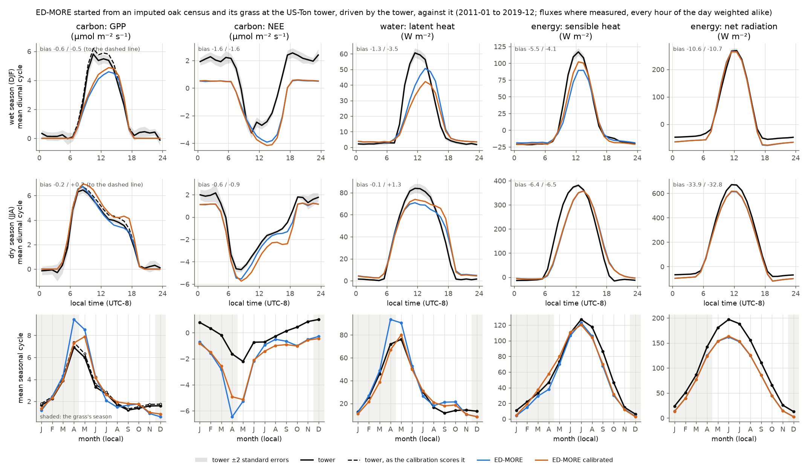
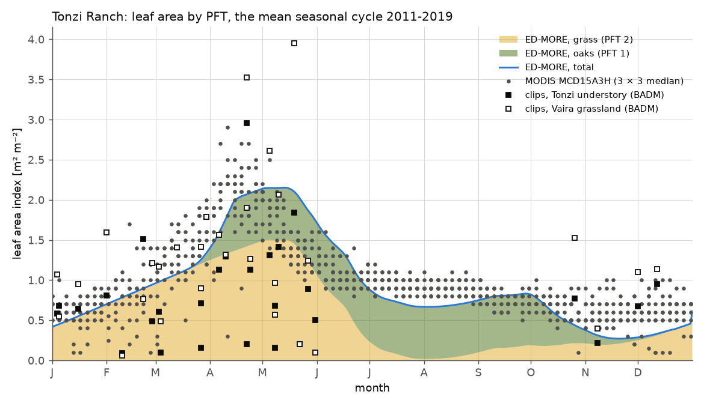

# Example 04, Tonzi Ranch — a blue-oak savanna and its grass (prototype)

Example 04's pipeline at a savanna: deciduous blue oaks over a C3 annual grass in the Sierra Nevada
foothills of California, the AmeriFlux tower US-Ton (23.5 m), 2010–2019. It is ED-MORE's first stand
with a plant that is not a tree: the grass has no stem, stands at its plant type's height and changes
only its leaf area ([`docs/science/plant_carbon_allocation.md`](../../../../docs/science/plant_carbon_allocation.md)
§2). **Status: prototype.**

The example:

1. builds the forcing from the tower's meteorology, with Vaira Ranch's where Tonzi measured nothing;
2. starts a frozen stand: oaks imputed from the site survey's stand averages, and the grass beneath and
   between them; its leaves follow the phenology fitted in example 02, part 3;
3. calibrates the fast parameters of both plant types against the tower;
4. compares the default and the calibrated runs with the tower, and each plant type's leaf area with
   MODIS and the clip LAI;
5. follows ten April days hour by hour: a canopy oak, the grass beneath it and the grass in the open,
   with their canopy air and soil.

## Run

```bash
cd examples/example04_column_biophysics/sites/tonzi
python run_site.py --ameriflux AMF_US-Ton_FLUXNET_2001-2025_v1.3_r1.zip --badm <base> --modis <modis>
python run_site.py ... --forcing-only          # the tower file and the forcing only
python run_site.py ... --calibrate --workers 60
```

`<base>` is the folder holding AmeriFlux's BASE-BADM zips of US-Ton and US-Var
(`AMF_US-Ton_BASE-BADM_27-5.zip`, `AMF_US-Var_BASE-BADM_27-5.zip`); they and the FLUXNET zip need an
AmeriFlux account. `<modis>` holds ORNL DAAC's MCD15A3H subset around the tower
(`us_california_tonzi_ranch_mcd15a3h_{Lai_500m,FparLai_QC}.csv`). Every step but the calibration takes
about 5 minutes on 32 cores with the dev build; `--calibrate` adds 9 minutes on 60 cores.

## The data

| Input | Source |
|---|---|
| Meteorology and fluxes | AmeriFlux US-Ton FLUXNET (ONEFlux v1.3_r1), CC-BY-4.0. Measured values only: [`prepare_tower.py`](prepare_tower.py) blanks the product's fills, and [`make_tower_forcing.py`](../../../../scripts/prepare_input/flux_tower/make_tower_forcing.py) fills the gaps by its own rules |
| Rain and pressure | US-Ton's BASE file (BASE-BADM 27-5; the FLUXNET product has none before 2021). Where Tonzi has none, or its file holds Vaira's readings, Vaira Ranch's (US-Var, 2.4 km away, 48 m lower) |
| Longwave | measured at Tonzi from 2014. Before, Vaira's less its mean excess over Tonzi's where both measure (10.4 W m⁻² over 2014–2019): half-hourly RMSE 12.1 W m⁻², against 21.8 for the forcing tool's own fill |
| Stand | an oak census imputed from the survey's stand averages (Kiang 2002, via Baldocchi, Xu & Kiang 2004, Agric. For. Meteorol. 123:13–39): 194 stems ha⁻¹ and 18 m² ha⁻¹ on 40 of 100 cells of 10 m. **Not measured trees** ([`make_tonzi_census.py`](make_tonzi_census.py)) |
| Traits | the oaks' and the grass's from the site literature, each value's source in [`pft_parameters.toml`](pft_parameters.toml) |
| Leaf area and phenology | the BADM's clip LAI (US-Ton understory, US-Var grassland), its oak and grass dates, PhenoCam's `tonzi_GR_1000` greenness (example 02, part 3) |
| Satellite leaf area | MODIS MCD15A3H collection 6.1 (4-day, 500 m; Myneni, Knyazikhin & Park 2021, doi:10.5067/MODIS/MCD15A3H.061), ORNL DAAC's subset around the tower |

Cite US-Ton's BASE as Ma, Xu, Verfaillie & Baldocchi, doi:10.17190/AMF/1245971, and US-Var's as
doi:10.17190/AMF/1245984.

## 1. The model

[`ed_config_eval.toml`](ed_config_eval.toml) runs 2010–2019; the scoring starts in 2011.
- **The stand is frozen** (`demography_on = false`): only the leaves change. The census's 100 cells
  restructure to 10 patches and 63 cohorts.
  - **The oaks** are 194 stems at the site's basal area. Their diameters are drawn with the spread of blue
    oak at NEON's San Joaquin Experimental Range: the survey's mean diameter (19.9 cm) does not fit its
    stem count and basal area. Their height curve passes through the survey's mean and tallest (7.1 and
    13.0 m), and their leaf area gives the trees' LAI, 0.65.
  - **The grass** is one row per cell, with dbh 0, of tillers 0.3 m tall. A cell in the open carries
    Vaira's open-grassland peak LAI (2.55, the median over 2002–2014 of each year's largest clip), a cell
    under the oaks the Tonzi understory's (1.31). The tiller count, 2,000 m⁻² in the open, is a choice: no
    count was found for these swards, and in a frozen stand only the leaf area and root length it gives
    matter.
- **Two plant types**: blue oak (a tree) and a C3 annual grass (`growth_form = "grass"`), their capacity,
  leaf mass per area, stomata, leaf angles, hydraulics and roots from the site literature. Two values are
  stand-ins: the oaks' leaf hydraulic conductance (Harvard's broadleaves'; none was found for blue oak)
  and the grass's Vcmax (none was found at leaf level).
- **The phenology** is fitted in [example 02, part 3](../../../example02_canopy_phenology/README.md#part-3--a-savanna-tonzi-ranch).
  The oaks flush on warmth and long days and drop their leaves on cold or drought. The grass grows and dies
  on water alone: its predawn leaf water potential summed above and below its turgor-loss point.
- **The soil** is a 9 m loam column with the water table at its base (`water_bottom_bc = "aquifer"`).
  Tonzi's soil is about 1 m of very rocky silt loam over fractured greenstone, with the water table 7–12 m
  down, and the oaks draw most of their summer water from it (Miller 2009). The column holds more water at
  depth than the saprolite does.
- **The oaks' roots reach the water table.** The share of their roots near it is fitted by hand to the
  tower's dry-season LE, and it leaves their late-summer predawn potential at −2 to −2.8 MPa. The site's
  profile, 70 % of the roots above 0.5 m, leaves them no root at the water table: the oaks then starve in
  the 2012–2015 drought, their storage emptied every autumn.
- **The momentum roughness is the landscape's.** At Vaira's 2 m sonic the aerodynamic canopy height is
  0.56–0.74 m in every month while the grass stands 0.04–0.55 m; `soil_rough` floors the canopy's height
  for its roughness at 0.65 m.

## 2. The calibration

[`calibration.toml`](calibration.toml) fits both plant types' capacity, stomata and leaf angles on the
grass's months (January–February), the oaks' (July–August) and April. It passes its own validation:
on the windows it held out, the cost falls by a quarter and LE's and GPP's RMSE by a third
([`calibration/report.md`](calibration/report.md)).

**It fails the full record: it halves the summer LE** (dry-season bias −19 W m⁻², against +3 for the
default). The default run is the site's reference; the calibrated one is kept for the diagnosis.

- **Both of the oaks' calibration windows fell in the 2014 drought** (14 July and 22 August): a window
  needs the longwave measured at Tonzi, from 2014 on, and of those summers 2014's were the best covered.
  By late August 2014 the oaks had nearly closed: from 9 to 16 h the tower's GPP was 1.5 µmol m⁻² s⁻¹
  and its LE 16 W m⁻², against the default's 4.0 and 39.
- **The fit closed the oaks' stomata to match:** Medlyn g1 0.76 (prior 1.92, beyond two prior sd, pushed
  by GPP) and Vcmax 61 (prior 113). One g1 serves every summer, so the wet summers lose most of their LE:

  | June–August, 9–16 h | 2011 | 2012 | 2013 | 2014 | 2015 | 2016 | 2017 | 2018 | 2019 |
  |---|---|---|---|---|---|---|---|---|---|
  | LE [W m⁻²]: tower | 118 | 74 | 42 | 44 | 53 | 66 | 85 | 67 | 117 |
  | default | 162 | 57 | 43 | 40 | 46 | 69 | 135 | 88 | 146 |
  | calibrated | 70 | 33 | 28 | 23 | 30 | 30 | 30 | 30 | 61 |
  | GPP [µmol m⁻² s⁻¹]: tower | 6.6 | 5.3 | 3.8 | 3.1 | 2.7 | 3.5 | 4.5 | 4.3 | 7.0 |
  | default | 12.5 | 5.1 | 4.1 | 4.0 | 4.4 | 5.7 | 9.9 | 7.3 | 11.0 |
  | calibrated | 6.3 | 3.1 | 2.7 | 2.5 | 3.0 | 2.7 | 2.8 | 2.9 | 5.2 |

- **The validation did not see it.** Its winter and April windows improved, and its two summer windows are
  late August (2017, 2019), when the default overshoots the tower by more than the calibrated run falls
  short (7–16 August 2017: tower 51, default 121, calibrated 23 W m⁻²).
- **Other windows do not cure it.** A test with summer windows from wet and dry years (calibration: July
  2019, August 2017, July and August 2014; validation: July 2017, July 2015, August 2019 and 2016) takes
  g1 to 0.69 again, now pushed by LE, and leaves the full record's summer LE bias at −13 W m⁻²: 42–77
  W m⁻² from 9 to 16 h in the wet summers.
- **The cause is the day's shape.** The tower's summer LE peaks at 11–13 h and falls through the
  afternoon: the oaks close. The model's do not. In the wet summers (2011, 2017, 2019) the default's LE
  holds its peak from 13 to 15 h, and at 16 h it is 139 W m⁻² against the tower's 77; in the drought
  summers (2012–2015) it is low in the morning (41 against 55 at 9 h) and high after 15 h. Both
  calibrations scale the whole day down and run flat, about 60 W m⁻² from 9 to 16 h in the wet summers.

  | June–August LE [W m⁻²], local hour | 7 | 9 | 11 | 13 | 15 | 16 | 17 |
  |---|---|---|---|---|---|---|---|
  | wet summers: tower | 59 | 98 | 119 | 120 | 100 | 77 | 53 |
  | default | 59 | 113 | 153 | 166 | 157 | 139 | 103 |
  | calibrated | 35 | 53 | 59 | 57 | 52 | 46 | 37 |
  | drought summers: tower | 31 | 55 | 61 | 57 | 43 | 33 | 22 |
  | default | 24 | 41 | 49 | 50 | 46 | 43 | 36 |
  | calibrated | 20 | 30 | 31 | 28 | 26 | 25 | 22 |

- **The default is not right either.** In the drought summers its LE is within 17 W m⁻² of the tower's;
  in the wet ones the oaks assimilate up to twice the tower's GPP and transpire 30–50 W m⁻² too much,
  most of it in the afternoon.
- **Why the model's oaks do not close.** On 4–15 July 2019, a wet summer, the canopy oak's leaves sit at
  −0.16 MPa before dawn and −1.0 to −1.2 MPa at midday (the default run restarted with the hourly
  cohort outputs of §5). That is above both of the model's water-stress thresholds: the predawn onset of
  the stomatal stress (−0.86 MPa) and the turgor-loss point (−1.71 MPa), where the capacity starts to
  fall. Their assimilation holds at 21–23 µmol m⁻² s⁻¹ from 9 to 16 h. The oaks' leaf hydraulic
  conductance is a stand-in (Harvard's broadleaves') and their pressure–volume curve the repository's
  default; their deep roots keep them wet. And over the summer the real oaks lose capacity (blue oak's
  Vcmax falls by more than 60 %, Osuna et al. 2015), which the model does not have. g1 cannot stand in
  for either.

## 3. Against the tower



Means over the tower's measured hours ([`plot_evaluation.py`](plot_evaluation.py)), every hour of the day
weighted alike, 2011–2019. The bias in the panels is against the tower as the calibration scores it
(GPP with the tower's respiration over the fitted kappa, H and LE with the energy-closure gap shared);
the tower closes its energy balance to 0.87 of the available energy (the daily median).

| run | GPP [µmol m⁻² s⁻¹] tower / model | LE [W m⁻²] | H [W m⁻²] | net radiation [W m⁻²] |
|---|---|---|---|---|
| default | 2.85 / 3.63 | 31.9 / 38.2 | 57.8 / 44.5 | 103.3 / 79.1 |
| calibrated | 2.85 / 3.49 | 31.9 / 28.7 | 57.8 / 51.7 | 103.3 / 78.1 |

- **The grass's season is right in timing, and its spring too productive.** From December to February
  the monthly GPP and LE are within 0.8 µmol m⁻² s⁻¹ and 4 W m⁻² of the tower's. In April and May, with
  the oaks leafing out over the grass at its peak, GPP runs 2.5–2.7 µmol m⁻² s⁻¹ and LE 16–21 W m⁻² high.
- **The oaks keep too much capacity in late summer.** From July to October GPP is 0.7–1.4 µmol m⁻² s⁻¹
  above the tower's. Blue oak's Vcmax falls by more than 60 % over the summer (Osuna et al. 2015); the
  model's stays at its spring value.
- **Net radiation is 38–45 W m⁻² short in summer**: from June to August the stand reflects 0.19 of the
  shortwave against the tower's 0.15, and the ground, bare under the dead grass, is hotter: 11 W m⁻² more
  longwave. The ground's albedo is the repository's default.

## 4. Leaf area



Each plant type's daily leaf area in the default run, the mean seasonal cycle over 2011–2019
([`plot_lai.py`](plot_lai.py)), against MODIS MCD15A3H (the median of the 3 × 3 pixels of 500 m around
the tower, good retrievals only) and the BADM's clips, each on its day of the year. A MODIS pixel holds
oaks, the grass between them and the grass beneath them; the clips are of the grass alone.

| months | ED-MORE, oaks + grass | MODIS | clips, Tonzi understory | clips, Vaira grassland |
|---|---|---|---|---|
| March–April (the grass at its peak) | 0.26 + 1.23 = 1.50 | 1.65 | 1.01 | 1.52 |
| July–August (the oaks alone) | 0.65 + 0.07 = 0.72 | 0.92 | – | – |
| December–January (the grass filling) | 0.01 + 0.45 = 0.46 | 0.62 | 0.71 | 0.96 |

- **The grass fills over the winter** after the first big rain and dies in May and June. Its peak follows
  the year's rain, from 1.34 in 2013 to 2.04 in 2017, and in March–April it sits between the understory's
  clips and Vaira's open grassland.
- **The stand's spring is about two weeks late.** The mean cycle peaks on 6 May at 2.1, MODIS's on
  20 April at 2.0, and it falls to half three weeks after MODIS's (20 June against 28 May): the model's
  grass peaks and dies late.
- **The summer and the winter are low against MODIS** by about 0.2: the oaks' 0.65 is the survey's LAI, and
  the 500 m pixel also holds standing dead grass and branches, which the retrieval does not tell from
  leaves. In December–January the grass is below both clip records.

## 5. Ten days inside the column


18–27 April 2016, local time, every hour: the default run to the window's start, writing its state, and a
restart from it with every patch's canopy air and soil and every cohort's leaves written each hour
([`output_window.toml`](output_window.toml), [`plot_window.py`](plot_window.py)). The restart continues
the run exactly. The grass is near its peak and the oaks are in leaf; four warm, clear days, 13.5 mm of
rain on the 22nd, a cooler week, and 31 mm on the 27th. Two patches: the largest under the oaks (14 % of
the site, LAI 2.4) with its tallest oak cohort (10 m) and the grass beneath it, and the largest in the
open (60 %, LAI 1.7), the grass alone.

- **The open is the warmer.** At midday on the warm days its canopy air is 2.0 °C above the forcing's air
  (0.6 under the oaks), and its soil 2.5 cm down reaches 38 °C (32 under the oaks).
- **The light sets the assimilation:** at midday on the clear days 23 µmol m⁻² s⁻¹ for the canopy oak's
  leaves, 13 for the open grass's and 10 for the shaded grass's.
- **The leaves' water potential** falls each afternoon and recovers each night: on the warm days to
  −0.8 MPa for the canopy oak, −1.1 for the shaded grass and −1.4 for the open grass, which draws on the
  drier topsoil.
- **The canopy air's CO₂** falls to 385–400 µmol mol⁻¹ by day (lower in brief dips at dawn and dusk) and
  rises to 400–420 at night; the swing is the wider in the open.
- **The storms wet the top 10 cm** from 0.14–0.17 to 0.30–0.37 m³ m⁻³; only the second reaches
  22.5 cm. At 45 and 80 cm the soil dries through the ten days, faster in the open (0.175 to 0.150 m³ m⁻³
  at 45 cm, against 0.188 to 0.174 under the oaks).

## Open

- **The census is imputed.** The survey's tree list (Kiang 2002) would replace it.
- **The oaks' afternoon closure and summer capacity** (§2): blue oak's own leaf conductance and
  pressure–volume curve, so their leaves dry through the day as measured, and a seasonal decline of
  Vcmax. Until then no calibration holds both the wet and the dry summers.
- **The ground's albedo and temperature** under the dead grass: the summer net radiation. MODIS's
  MCD43A3 albedo over the tower is the check.
- **The grass's germination** is its weakest timing (example 02, part 3), and its leaves are one big
  leaf at the bottom of the canopy; standing dead grass is not represented.
- **The deep water**: one loam curve to 9 m holds more water than the saprolite, and the oaks' root
  share near the water table is fitted.

## Files

| File | What it is |
|---|---|
| [`run_site.py`](run_site.py) | the steps above |
| [`prepare_tower.py`](prepare_tower.py), [`tonzi_site.toml`](tonzi_site.toml) | the tower file and its declaration |
| [`make_tonzi_census.py`](make_tonzi_census.py) | the imputed oaks, the grass, and the steady litter input for the soil carbon |
| [`ed_config_eval.toml`](ed_config_eval.toml), [`pft_parameters.toml`](pft_parameters.toml), [`output_variables.toml`](output_variables.toml) | the default run |
| [`calibration.toml`](calibration.toml), [`calibration/`](calibration) | the calibration and its results |
| [`output_window.toml`](output_window.toml) | the ten-day window's hourly variables |
| [`plot_evaluation.py`](plot_evaluation.py), [`plot_lai.py`](plot_lai.py), [`plot_window.py`](plot_window.py) | the figures |
