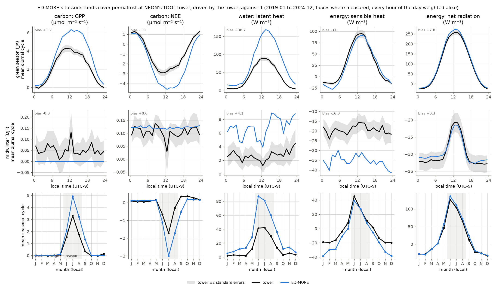

# Example 04, Toolik — tussock tundra over permafrost (prototype)

The coupled column in moist acidic tussock tundra on the northern foothills of the Brooks Range, Alaska, at
NEON's TOOL tower (AmeriFlux US-xTL, 8.9 m), 2019–2024. It is ED-MORE's first site over permafrost: an 18 m
soil column whose base is the permafrost's temperature, peat over mineral soil, a moss layer on the ground,
snow that buries the plants, and dwarf shrubs, woody plants sized by their stems' diameter at the ground.
**Status: prototype.** The calibration and the phenology fit (example 02's part 4) are not run yet.

The example:

1. builds the forcing from the tower's measured meteorology, with a nearby station's humidity and
   precipitation and the FLUXNET product's ERA5 wind and pressure where the tower measured nothing;
2. builds the soil column from NEON's soil pit and Imnavait Creek's peat, and a frozen stand from the site's
   harvest and plant cover, each plant type on its own land-cover patch;
3. spins the permafrost column up for 30 years on the six tower years;
4. compares the six tower years with the tower's fluxes, and the soil's temperature with NEON's sensors.

## Run

```bash
cd examples/example04_column_biophysics/sites/toolik
python run_site.py --data <toolik> --ameriflux AMF_US-xTL_FLUXNET_2019-2024_v1.3_r1.zip
python run_site.py ... --forcing-only          # the tower file and the forcing only
python plot_evaluation.py                      # the figure and output/evaluation_stats.json
```

`<toolik>` holds:
- `neon/`: NEON's soil pit (DP1.00096.001), soil temperature (DP1.00041.001) and plant cover (DP1.10058.001);
- `ornl_above/`: ORNL DAAC's Imnavait soil pits (`Arctic_Soil_Properties`, dataset 2149) and the Toolik
  Lake vegetation plots (`Toolik_Lake_Veg_Plots`, dataset 1333);
- `arc_lter/`: the ARC LTER MAT06 harvest (knb-lter-arc.20158.2);
- `uscrn_toolik/hourly02/`: the USCRN station's hourly files;
- `berner2015/`: Appendix A of Berner et al. (2015), the harvested shrubs (Elsevier's supplementary file
  `1-s2.0-S0378112714006094-mmc1.csv`).

The FLUXNET zip needs an AmeriFlux account. [`toolik_traits.py`](toolik_traits.py) prints the soil
column's values in [`ed_config_eval.toml`](ed_config_eval.toml). Every step takes about 9 minutes on 4
threads with the dev build: the spin-up's 30.5 years and the six tower years.

## The data

| Input | Source |
|---|---|
| Meteorology and fluxes | AmeriFlux US-xTL FLUXNET (NEON TOOL; ONEFlux v1.3_r1), CC-BY-4.0. Measured values only: [`prepare_tower.py`](prepare_tower.py) blanks the product's fills, and [`make_tower_forcing.py`](../../../../scripts/prepare_input/flux_tower/make_tower_forcing.py) fills the gaps by its own rules. The product has no turbulent fluxes in 2020 |
| Humidity and precipitation | the tower's, and where it has none NOAA USCRN Toolik Lake 5 ENE's, 1.6 km away (public domain): its humidity, and its shielded gauge's precipitation, else the product's ERA5 |
| Wind and pressure | the FLUXNET product's ERA5 where the tower has none: its sonic misses 2020 and a third of the other years |
| Soil | NEON's soil pit (DP1.00096.001, April 2016): Oi 0–6 cm, Oe and Oa peat to 21 cm, then gleyed silt loam with gravel (Bg, Cg) to 73 cm. The peat's water retention from the Imnavait Creek pit IMN-1 (ORNL DAAC 2149, Bakian-Dogaheh et al. 2023) |
| Permafrost | −4.4 °C at 20 m: the Galbraith Lake borehole, 25 km south (Romanovsky, Cable & Kholodov 2015), carried to 2021 at its trend |
| Stand | the ARC LTER MAT06 control plots' harvest (2012, 10 km away; knb-lter-arc.20158.2), split among the plant types by NEON's cover (DP1.10058.001, 2019–2024). **Not measured plants** ([`make_toolik_census.py`](make_toolik_census.py)) |
| Shrub allometry | the dwarf birch harvested by Berner et al. (2015, Appendix A); the shrubs' heights from Walker & Barry's Toolik Lake plots (ORNL DAAC 1333) and the Tundra Trait Team (Bjorkman et al. 2018) |
| Traits | from the site literature, each value's source in [`pft_parameters.toml`](pft_parameters.toml) |

## 1. The model

[`ed_config_eval.toml`](ed_config_eval.toml) runs 2019–2024 from the spin-up's state; every day is scored.

- **The stand is frozen** (`demography_on = false`): only the leaves change. Plants that do not compete for
  light do not share a patch, so each plant type is one cohort on its own land-cover patch:

  | patch | share of the ground | plant type | height | stem diameter, plants per m² of the site | leaf area [m² m⁻² of the site] |
  |---|---|---|---|---|---|
  | 1 | 13.6 % (NEON's cover) | deciduous dwarf shrubs (Betula nana, Salix pulchra) | 20 cm | 2.6 mm, 172 m⁻² | 0.31 |
  | 2 | 11.0 % (NEON's cover) | tussock sedge (Eriophorum vaginatum, Carex bigelowii), a grass | 14.6 cm | 1,000 tillers m⁻² | 0.25 |
  | 3 | the rest, 75.4 % | evergreen dwarf shrubs (Rhododendron tomentosum, Vaccinium vitis-idaea, Empetrum, Cassiope) in the moss between the tussocks | 8 cm | 0.89 mm, 4,500 m⁻² | 0.36 |

  The leaf area is MAT06's green leaves at each type's specific leaf area, 0.91 in all, split by NEON's
  cover. Each shrub type keeps MAT06's stems per leaf area.
- **The shrubs' allometry** is fitted on Berner et al.'s 52 harvested dwarf birch, the stem's diameter D at
  the ground (`diameter_height = 0`): height 62.7 D^0.85 cm, wood (stem and branch) 25.9 D^2.92 g, and the
  leaf area following the new growth, 4.8 D^2.41 g. The paper finds the same birch allometry in tundra and
  boreal forest, and its tundra willows from the foothills near Toolik give nearly the same height law. No
  evergreen dwarf shrub was harvested, so both shrub types take the birch's laws. The deciduous shrubs stand
  at the shrub height of Walker & Barry's six tussock-tundra plots at Toolik Lake (median 20 cm); there the
  birch's new growth is 0.37 of its wood, as MAT06's deciduous new leaves and stems are 0.40 of their old
  stems. The evergreens stand at Ledum palustre's median height north of 60° N (Tundra Trait Team, 190
  plants), Ledum holding three quarters of their stems.
- **The phenology** has starting values, not a fit: every type flushes on warmth and long days and sheds on
  cold and short days, the cues set on the deciduous shrubs' dates at NEON TOOL (half green about day 175,
  bare by day 245). The evergreens keep half their leaves through the winter, the sedge a tenth.
- **The roots** reach Alaska's maximum rooting depths for the species (Chapin et al. 1996): 34 cm for the
  sedge, 14 for the deciduous shrubs, 9.5 for the evergreens, below the moss.
- **The soil** is 18 m in 20 layers, 5–9 cm thick through the horizons and the active layer. The Oe and Oa
  take the Imnavait pit's hemic and sapric peat; the mineral horizons, the model's texture formulas on the
  pit's texture. The permafrost seals the base (no drainage), and the base conducts to the borehole's
  −4.4 °C at 20 m. The pit's Oi, 6 cm of live and dead moss, is the moss layer on the soil
  ([`docs/science/surface_organic_layer.md`](../../../../docs/science/surface_organic_layer.md)).
- **The snow** lies on the moss and buries the plants from their crowns' base up
  ([`docs/science/snow_biophysics.md`](../../../../docs/science/snow_biophysics.md)).
- **The roughness is 0.076 of the canopy height,** fitted: the patches' roughness, blended at the tower
  (Mason 1988), gives the tower's near-neutral roughness in June–August, 0.0076 m. The plants are sparse and
  the moss shows between them; the model's default, 0.13, is a dense canopy's and makes u\* a quarter too
  high.
- **The spin-up** runs 30.5 years from 2 July 1988 on the six tower years, recycled. It starts from the
  census in midsummer, when its full leaf is the stand's own, and NEON's soil temperatures of 1–2 July 2019;
  the soil carbon starts at its steady state with the stand's litter. Its state on 2 January 2019 starts the
  run ([`run_site.py`](run_site.py)).

## 2. The calibration

Not run yet. [`calibration.toml`](calibration.toml) fits the three types' capacity and stomata on
June–August windows, each chain running a year of phenology from the spin-up's state to the window's own
canopy.

## 3. Against the tower



Means over the tower's measured hours, 2019–2024, every hour of the day weighted alike
([`plot_evaluation.py`](plot_evaluation.py)):

| | tower | ED-MORE | June–August bias | December–February bias |
|---|---|---|---|---|
| GPP [µmol m⁻² s⁻¹] | 0.59 | 0.97 | +1.21 | −0.05 |
| NEE [µmol m⁻² s⁻¹] | −0.09 | −0.43 | −1.05 | +0.02 |
| LE [W m⁻²] | 13.3 | 30.4 | +38.2 | +4.1 |
| H [W m⁻²] | −1.6 | −10.8 | −3.0 | −16.0 |
| net radiation [W m⁻²] | 17.2 | 21.5 | +7.8 | +0.3 |

- **The net radiation follows the tower** through the year, the snow's albedo and the polar night included.
- **The summer's LE is twice the tower's,** 81–87 against 41–42 W m⁻² in June and July, while H follows it.
  About half of the excess is the tower's: over the summer hours it measured all four fluxes, its H + LE
  close to 0.71 of its net radiation less its ground heat flux, 24 W m⁻² short, about 14 of them LE at its
  own Bowen ratio. The rest is the model's: 9 W m⁻² more net radiation and more of it as LE.
- **The season is too productive and too long:** GPP peaks at 4.9 against 3.3 µmol m⁻² s⁻¹ in July and
  stays at 1.4 in September, when the tower's is 0.35. The phenology's starting values shed the leaves
  late; example 02's part 4 is to fit them.
- **In winter the air heats the snow:** H is −30 to −39 W m⁻² against the tower's −17 to −20, and the snow
  sublimes about 4 W m⁻² more. The ground is too cold (section 4), so the snow draws its heat from the air
  instead.

## 4. The soil and the snow

The model's daily soil temperature against NEON's sensors at the tower (FLUXNET's TS_F_MDS_1, 4 and 7),
2019–2024, the model's depth below the moss's top:

| °C | 2 cm, tower / ED-MORE | 26 cm | 56 cm |
|---|---|---|---|
| annual mean | −0.6 / −3.2 | −1.3 / −3.9 | −1.5 / −4.0 |
| June–August | 7.7 / 6.8 | 1.7 / 2.0 | −0.2 / 0.7 |
| December–February | −4.7 / −9.9 | −2.6 / −8.6 | −1.6 / −7.8 |
| maximum | 19.6 / 14.3 | 5.5 / 6.2 | 1.2 / 4.0 |

- **The ground is about 2.5 °C too cold over the year and 5–6 °C in winter,** at every depth: the column
  settles to the borehole's −4.4 °C at 20 m, where NEON's 56 cm sensors average −0.1 to −1.9 °C.
- **The summer reaches too deep:** at 56 cm the model peaks at 4.0 °C, the tower at 1.2. The model thaws
  to 1.4–1.7 m in most years (2.5 m in 2019), against CALM's 45 cm on the moist acidic tundra plots and a
  thaw just past NEON's 56 cm sensors.
- **The snow comes and goes on time:** 0.34–0.50 m in April (0.96 m in 2019) and gone by 21–29 May; the
  Toolik Field Station's sonic sensor peaks at 26–60 cm with the ground bare by 3–27 May, and the Imnavait
  SNOTEL, 6 km away, at 58–114 cm, bare by 19 May–19 June.

## Limitations

1. **The ground's temperature.** Too cold in winter and thawing too deep in summer, the soil swings too far
   both ways. Three causes to test: the base held at Galbraith Lake's −4.4 °C, where TOOL's ground is
   warmer; the snow's insulation; and the mineral soil's ice, whose latent heat slows the thaw.
2. **The summer's LE.** Half the excess is the tower's closure gap, which the calibration can share out as
   at BCI and Harvard; the rest is the model's, to be read after the calibration and the phenology fit.
3. **The evergreens are upright shoots.** The height law is for erect stems, whose height is their length;
   Toolik's evergreens creep, their stems longer than the canopy is tall, so at 8 cm the stand holds 4,500
   stems m⁻² of 0.89 mm. A Ledum law (Rhododendron groenlandicum in a Minnesota bog, SPRUCE) would make them
   17,500 of 0.52 mm: tested, it moves the summer's LE by −3.7 W m⁻², H by +4.7 and net radiation by +2.5,
   through the 2.3 times larger wood area, and leaves GPP unchanged.
4. **The roughness is fitted, not computed.** z0/h depends on the canopy's density; Raupach (1994) gives it
   from the plant area, which would let it follow the leaves and the snow through the year.
5. **The water solves.** 357 soil-water solves in the spin-up and 120 in the six years do not converge; the
   solver carries them through, and the water and energy budgets still close.
6. **The stand is not a census.** One cohort per plant type, from a 2012 harvest 10 km away and NEON's
   cover; the moss neither photosynthesises nor transpires.

## Files

| File | What it is |
|---|---|
| [`run_site.py`](run_site.py) | runs every step |
| [`prepare_tower.py`](prepare_tower.py), [`toolik_site.toml`](toolik_site.toml) | the tower file and its declaration |
| [`toolik_traits.py`](toolik_traits.py) | the soil column's horizons and its starting temperature |
| [`make_toolik_census.py`](make_toolik_census.py) | the stand from the harvest and the cover, the shrubs' allometry, and the steady litter input for the soil carbon |
| [`ed_config_eval.toml`](ed_config_eval.toml), [`pft_parameters.toml`](pft_parameters.toml), [`output_variables.toml`](output_variables.toml) | the ED-MORE run, its PFTs and its output |
| [`calibration.toml`](calibration.toml) | the calibration's Toolik choices |
| [`plot_evaluation.py`](plot_evaluation.py) | the figure |
